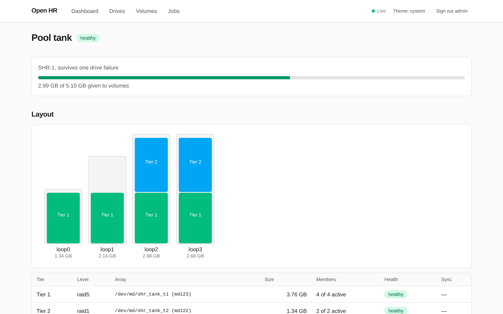
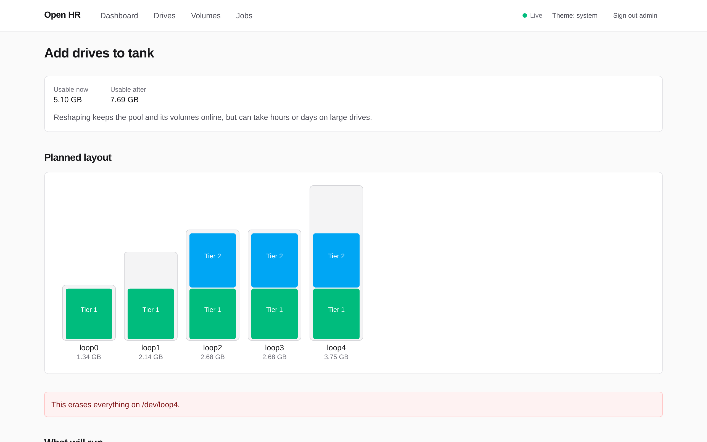
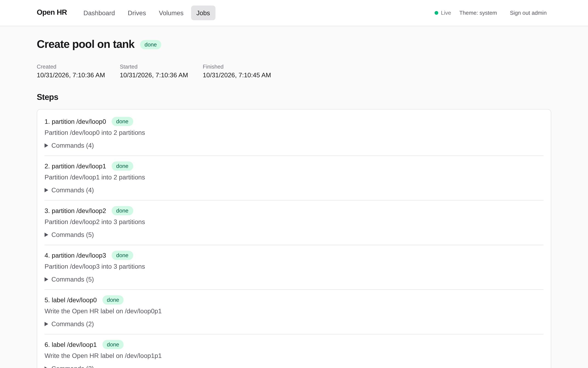

# Open Hybrid RAID (ohr)

**Synology Hybrid RAID for any Linux box.** Put drives of any sizes into one
redundant pool, use almost all of their capacity, and grow the pool later by
adding drives or swapping in bigger ones. It's built on plain `mdadm` and LVM,
and you manage it from a web UI or a CLI.

<picture>
  <source media="(prefers-color-scheme: dark)" srcset="docs/images/pool-dark.png">
  
</picture>

> **Status: 0.2, pre-release.** You can create pools and volumes, grow a pool
> by adding drives, and replace drives, from the browser or the CLI. Hot
> spares, scrubs, and alerts come in later releases. Try it in a VM or on
> spare drives first. Do not trust it with the only copy of your data.

## Why

Plain RAID5 sizes every drive down to the smallest one. With a 4, 8, 8, and
12 TB drive you get 12 TB usable, and the rest goes to waste. SHR slices the
drives into _tiers_ and builds one RAID array per tier, so the same four drives
give you 20 TB with the same protection against one failed drive:

```console
$ ohr plan --redundancy shr1 --sizes 4TB,8TB,8TB,12TB
SHR-1 plan for 4 drives
Usable capacity: 19.99 TB of 32.00 TB raw

Tiers
  TIER  LEVEL  PARTITION  SLICE    MEMBERS  USABLE
  1     raid5  2          3.99 TB  4        11.99 TB
  2     raid5  3          3.99 TB  3        7.99 TB
```

Synology only offers this on its own NAS hardware. Open HR builds the same
layout on stock Debian or Proxmox, from the same parts Synology uses underneath:
GPT partitions, `mdadm`, LVM, and btrfs or ext4 on top.

## Features

**Works today**

- Pools of mixed drive sizes with one-drive (SHR-1) or two-drive (SHR-2) redundancy.
- btrfs or ext4 volumes, mounted under `/mnt/ohr`.
- Online growth: add a drive, or swap a drive for a bigger one. New tiers and
  RAID1 to RAID5 conversions happen as needed, and a volume can grow into the new space.
- Every job shows a preview of the exact commands it will run before it starts,
  and checks the real state of the drives right before each step.
- Jobs survive a crash or a reboot and pick up where they left off.
- Pools assemble and mount at boot with no Open HR service needed.

**Coming next**

- Hot spares, scheduled scrubs, SMART monitoring, and webhook alerts.
- Snapshots, encryption, and SSD cache.

See the [roadmap](docs/PLAN.md#10-roadmap) for the full plan.

## A look around

Before anything touches a drive, Open HR shows what the pool will look like and
every command it will run. Here a 3.75 GB drive joins the pool above:

<picture>
  <source media="(prefers-color-scheme: dark)" srcset="docs/images/add-drive-dark.png">
  
</picture>

Each change runs as a job made of small steps you can follow live, with the
commands and output of each step one click away:

<picture>
  <source media="(prefers-color-scheme: dark)" srcset="docs/images/job-dark.png">
  
</picture>

_The screenshots come from a test VM, so the drives are small loop devices._

## Your data stays yours

Open HR uses no format of its own. A pool is GPT partitions, `mdadm` arrays,
and an LVM volume group, so plain Linux tools can read and repair it. Remove
Open HR, or lose the machine it ran on, and the pool still assembles anywhere
`mdadm` and LVM do. The design and its safety rules are in the
[project plan](docs/PLAN.md).

## Install

On Debian 12 or 13, or Proxmox VE 8 or 9, on amd64:

```sh
curl -fsSL https://raw.githubusercontent.com/nvitaterna/open-hr/main/deploy/install.sh | sudo bash
```

The script downloads the newest release's `.deb` from GitHub, checks its
SHA-256, and installs it with apt. It prints the address of the web interface,
`https://<this machine>:7700`, and a one-time setup token. The certificate is
self-signed, so the browser warns once. Running the script again upgrades.

- `sudo ohr status` shows drives, arrays, and volume groups from the shell.
- `sudo ohr help` lists the CLI commands: pools, volumes, drives, and jobs.
- `sudo ohr-web setup-token` makes a new token, which is also how you reset a
  forgotten password.
- Removing the package leaves pools and volumes alone.

## Run from a build

```sh
pnpm install && pnpm build
alias ohr="node $PWD/packages/cli/dist/bin.js"

ohr plan --redundancy shr1 --sizes 4TB,8TB,8TB      # layout for hypothetical drives, no daemon needed
```

Everything else goes through `ohr-core`, the root daemon. Start it in one
terminal and use the CLI from another:

```sh
sudo node packages/core/dist/daemon/main.js --group "$(id -gn)"
ohr status                                          # drives, arrays, volume groups
ohr status --smart                                  # with SMART health
ohr pool create --id p1 --redundancy shr1 /dev/sdb /dev/sdc
ohr job list
```

## Development

```sh
corepack enable
pnpm install
pnpm check      # lint, typecheck, and unit tests
pnpm dev        # ohr-core under sudo, ohr-web, and the UI with hot reload, on a test machine
pnpm package    # the .deb, in deploy/out (needs nfpm)
```

Storage changes are tested against real `mdadm` and LVM on loop devices. Read
[CONTRIBUTING](CONTRIBUTING.md) before opening a pull request.

## Documentation

- [Project plan](docs/PLAN.md): how SHR works, the design, the safety model, and the roadmap
- [Decision records](docs/decisions)
- [Contributing](CONTRIBUTING.md)
- [Security policy](SECURITY.md)

## Licence

[MIT](LICENSE)
